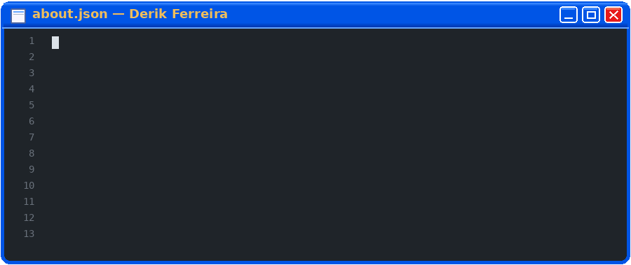
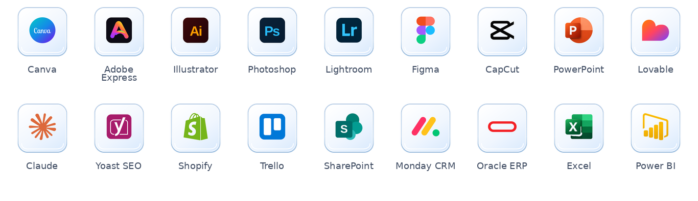
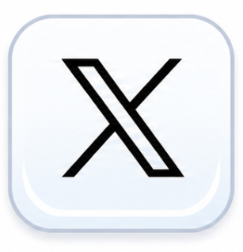

  

  <picture>
    <source media="(max-width: 600px)" srcset="assets/about-derik-mobile-en.gif" />
    
  </picture>

[Leia em português 🇧🇷](README.pt-BR.md)

I'm a **communication and marketing professional** working at the intersection of **sports, visual storytelling, editorial research and data**. I work in institutional communications at **AVSI Brasil** and previously worked in marketing and communications at **Voltalia**. I'm currently studying **Data Analytics at SENAC**.

### Main skills

### Studying

### Publications

 

Selected published articles at **Ludopédio**:

- [The evolution of Botafogo's shirt: from the original white to the iconic stripes](https://ludopedio.org.br/arquibancada/a-evolucao-da-camisa-do-botafogo-do-branco-original-ao-manto-glorioso/) — August 2026.
- [Tévez at Corinthians: the legacy of the Apache at Parque São Jorge](https://ludopedio.org.br/arquibancada/tevez-no-corinthians-o-legado-do-apache-no-parque-sao-jorge/) — May 2026.

### Connect with me!

    &nbsp; 

### Employer?

> [!IMPORTANT]
> Interested in **communications, sports marketing, content or data-informed creative work**? [Get in touch](mailto:derikferreirawork@gmail.com) or [request my latest résumé](mailto:derikferreirawork@gmail.com?subject=CV%20request%20-%20Derik%20Ferreira).

